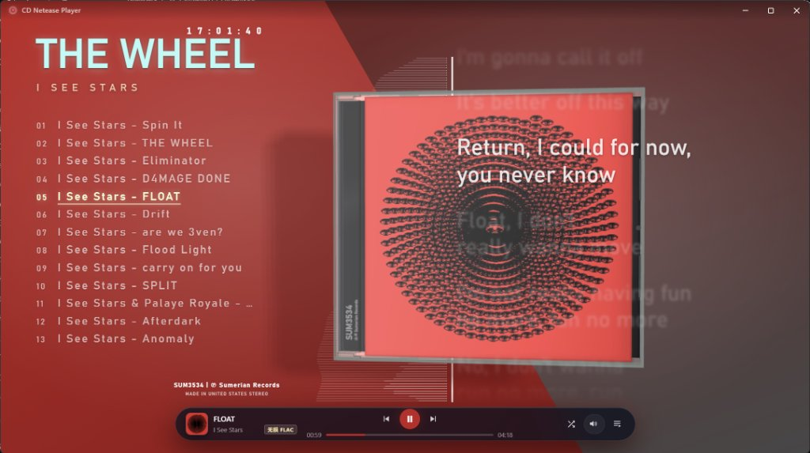
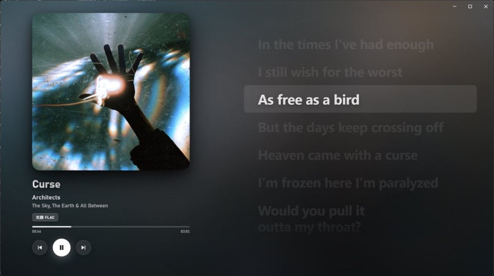

# 💿 CD Netease Player

<p align="center">
  
</p>

<p align="center">
  <strong>沉浸式 3D 拟物 CD 盒 × 网易云音乐桌面播放器</strong><br>
  整合 Apple Music Like Lyrics (AMLL) 逐字灵动流光歌词 · MOLAN-AV3A 全景声解码引擎 · 全新悬浮胶囊播控与全屏沉浸聚焦
</p>

<p align="center">
  <a href="LICENSE"></a>
  <a href="https://github.com/Eakissa/CD-Netease-Player/releases"></a>
  
  
  
</p>

---

## 🖼️ 界面预览 (Screenshots)

<div align="center">
  <p><strong>💿 3D 拟物 CD 盒常态模式</strong><br>
  （3D 亚克力包装盒自由拖拽自旋 · 灵动悬浮胶囊底栏 · 左侧专辑信息安全防撞色随机选色 · 动态伴奏歌词）</p>
  
  <br><br>
  <p><strong>🎤 全屏沉浸歌词聚焦模式 (Focus Mode)</strong><br>
  （4K 视网膜全景液态流动流光 · 巨幅专辑封面与播控 · AMLL 官方原生逐字流光歌词与悬浮胶囊高亮 · 歌词行点击毫秒级跳转）</p>
  
</div>

---

## ✨ 核心特性

### 1. 💿 3D 拟物亚克力 CD 盒物理渲染与交互
- **真实光影材质**：基于 WebGL 打造的超写实透明亚克力外壳、光盘内托槽、半透明盘片反射与背透漫反射。
- **动态换碟退碟**：切歌时自动播放开盖、退碟、装盘与闭合动作，音质变化自适应换碟。
- **自由手势物理交互**：
  - 按住鼠标左键可自由三维倾斜拖拽；
  - 鼠标滚轮任意角度自旋（带角动量阻尼惯性）；
  - 双击极速甩转甩盘；
  - 鼠标滚轮中键单击平滑归中回正。

### 2. 💊 全新灵动拟物悬浮胶囊底栏 (Floating Island Capsule)
- **浮岛式拟物胶囊**：采用深色磨砂亚克力玻璃材质，搭配微妙内外高光阴影，完全脱离传统死板底栏。
- **全要素曲目信息**：集成方形微缩封面、曲目名称、歌手名与金色音质徽标（`无损 FLAC` / `Hi-Res` / `极高`）。
- **完整播控与进度交互**：上一首、播放/暂停、下一首、单曲循环/列表播放/随机播放切换、实时音量滑块与一键静音。
- **支持自动隐藏**：在杂项设置中开启后，底栏闲置自动向下收起淡出，鼠标靠近底部平滑唤出。

### 3. 🎤 Apple Music Like Lyrics (AMLL) 沉浸聚焦模式
- **4K 视网膜全景液态流动背景**：采用超大平滑封面高斯模糊、SVG 抗色阶微噪点与液态流动色彩网格，彻底消除标清色块断层。
- **巨幅专辑封面与沉浸播控**：左侧展示超大封面艺术、专辑标题、艺术家名、音质徽标与专属进度条控制器。
- **AMLL 官方原生质感**：
  - 完美呈现网易云最新 YRC 逐字逐音节跳动光效；
  - 还原 AMLL 原生半透明圆角胶囊悬浮高亮（鼠标放置呈现 `pointer` 手势，未播放行自然清晰）；
  - **点击歌词直接精准跳转 (Click to Seek)**：点击任意歌词行，音频即刻精准定位到该句并继续播放，双端进度毫秒级同步；
  - 支持歌词中文翻译一键对照（「译」）与罗马音音标注音（「音」）。

### 4. 🎨 多背景主题模式与智能安全选色系统
- **三种风格背景随心切换**：
  - **默认流光模式**：经典干净的大气流光；
  - **双特征色模式 (Dual-accent)**：自适应提取封面两组高反差互补主色，生成动感对角渐变；
  - **极简沉浸灰阶模式 (Monochrome)**：高级冷灰深炭配色，专为黑白、冷调石膏专辑定制，消除紫色偏色。
- **常态左侧专辑信息安全防撞色选色系统**：
  - 针对非聚焦模式下的专辑名 (`#title`)、乐队名 (`#note`)、当前播放歌曲 (`#tracks li.current`) 与进度下划线 (`#marker`) 实施个性化动态随机选色；
  - **智能防撞色轻量化检查**：感知当前面板真实底色，严格避开底色色相 $\pm 35^\circ$ 范围内的脏色，并进行 WCAG 对比度（$\ge 3.8:1$）与 RGB 欧氏距离检查，既绚烂夺目又保证文字极致清晰可读。

### 5. 🧠 记忆播放系统 (Playback Memory)
- **退出与重启无缝接力**：自动在本地持久化记忆当前播放列表、全部曲目、队列模式以及退出前停留的歌曲序号与进度。
- **安静待命不扰民**：再次启动播放器时自动恢复唱片机陈列与界面状态，保持暂停就绪待命，绝不自作主张突兀起播。

### 6. ⚡ 应用内极速多级热更新系统 (In-App Quick Updater)
告别以往“每次更新都要重新下载 130MB 全量包再解压覆盖”的繁琐流程！
- **✨ 增量微补丁 (Micro-patch, <100 KB)**：
  - 界面与播放逻辑更新仅需下载 **几十 KB** 的补丁包；
  - 在「右侧抽屉 → 杂项菜单」中点击“检查更新”，几秒内自动下载并完成热更新，无需重启整个系统；
  - 自动保留基底版本与补丁标记，并在更新弹窗中支持**一键回退到原始基底**，安全无忧。
- **📦 核心更新 (Core asar update)**：针对深层核心改动，提供约 20MB 的快速更新，解压覆盖 `resources/app.asar` 即可。
- **🚀 国内多线路加速切换**：针对国内网络环境，更新界面提供 FastGit、Ghproxy 等镜像节点加速下载选项。

### 7. 🎧 全格式解码与网易云无缝生态
- **内置 MOLAN-AV3A 全景声解码器**：完美兼容网易云 AV3A / AV3V 全景声音轨，通过智能空间虚拟化下混呈现环绕立体声场。
- **收藏专辑 3D 展架**：读取个人歌单与云端收藏专辑，专辑在抽屉中以唯美 3D CD Case 格式陈列，支持点播与整专换碟播放。

---

## ⚡ 极速更新功能使用指南

如果你当前正在使用任何已安装版本（v1.0.8 / v1.0.9 或更新版本）：

```text
1. 打开右侧抽屉（点击右上角抽屉按钮或从右侧边缘向左轻拉）
2. 在抽屉顶部找到并点击「杂项菜单」
3. 点击「检查更新」按钮
4. 播放器将自动连接 GitHub Releases 获取最新版本更新日志与更新包：
   - 检测到微补丁（绿色标签）：点击「一键应用更新」，约 1~2 秒即可完成并热重启生效！
   - 若国内网络连接较慢，可勾选「使用国内镜像加速下载」
5. 如需恢复到纯净初始基底，在弹窗中点击「回退至原始基底版本」即可
```

---

## 🚀 快速上手与运行

### 方式一：直接下载开箱即用（推荐）
前往 [GitHub Releases](https://github.com/Eakissa/CD-Netease-Player/releases/latest) 下载最新的 **`CD-Netease-Player-v*-win-x64.zip`**，解压后双击 `CD Netease Player.exe` 即可启动。

### 方式二：从源码运行与构建

#### 运行环境
- Node.js (推荐 Node.js 18 ~ 22)
- Windows 10 / 11

#### 1. 克隆仓库并安装依赖
```bash
git clone https://github.com/Eakissa/CD-Netease-Player.git
cd CD-Netease-Player
npm install
```

#### 2. 启动开发模式
```bash
npm start
```

#### 3. 自动打包（生成绿色版、微补丁与全量 Zip 包）
```bash
npm run build
```
打包脚本将自动在 `dist/` 目录下生成：
- `patch-v*.zip`（轻量微补丁包）
- `app-update.zip`（核心 app.asar 更新包）
- `CD-Netease-Player-v*-win-x64.zip`（完整独立便携免安装包）

---

## ⌨️ 常用快捷键

| 按键 | 功能 |
| :--- | :--- |
| `空格 (Space)` | 播放 / 暂停 |
| `→` / `Ctrl + →` | 下一首 |
| `←` / `Ctrl + ←` | 上一首（播放时间 > 3 秒时跳至开头，否则切上一首） |
| `Shift + →` | 快进 5 秒 |
| `Shift + ←` | 快退 5 秒 |
| `↑` / `↓` | 调节音量（伴随悬浮 HUD 提示） |
| `Esc` | 退出聚焦模式 / 返回全部专辑 / 收起抽屉或选单 |
| `鼠标滚轮` | 在 3D CD 盒上滚动可自旋唱片机（带惯性物理阻尼） |
| `鼠标滚轮中键` | 单击平滑回正 3D CD 盒角度 |

---

## 📜 开源协议与致谢声明 (Credits & License)

本项目采用 **[GNU General Public License v3.0 (GPL-3.0)](LICENSE)** 协议开源。

### 核心依赖与第三方资产致谢
1. **[applemusic-like-lyrics](https://github.com/Steve-xmh/applemusic-like-lyrics)**
   - 优秀的 Apple Music 风格动态歌词渲染框架，采用 **GPL-3.0** 协议，本项目歌词渲染严格遵循其开源协议。
2. **[NeteaseCloudMusicApi](https://github.com/Binaryify/NeteaseCloudMusicApi)**
   - 网易云音乐 Node.js API 引擎，采用 **MIT** 协议。
3. **[MOLAN-AV3A](https://github.com/baiji6/MOLAN-AV3A)**
   - AVS3 Audio (Audio Vivid) 解码引擎及社区算法实现。
4. **[Spinning CD Case — Music Visualizer](https://steamcommunity.com/sharedfiles/filedetails/?id=3828403978)** (Steam Workshop ID: `3828403978`)
   - 核心 3D WebGL 亚克力 CD 包装盒模型、着色器与动态视觉渲染移植自 Steam Wallpaper Engine 创意工坊作者 **[sbeuwu](https://ko-fi.com/sbeuwu)** 的优秀独立作品，在此向原作者致以崇高敬意。
5. **全套字体资产 (`fonts/`)**
   - 均采用 **SIL Open Font License 1.1 (OFL)** 协议开源（附带官方许可证文件）。

### ⚠️ 免责声明 (Disclaimer)
- 本项目为个人针对前端 3D 渲染、Web Audio 空间音频与灵动歌词交互整合的**技术研究与非商业开源交流项目**。
- 本软件不提供任何商业收费服务，不破解或篡改任何音频接口付费逻辑。用户登录与会员权益均依托于用户自身的网易云账号及官方服务。
- 若相关资产作者或版权方对开源引用存在异议，请提交 Issue 或联系我们，我们将第一时间积极配合调整。
